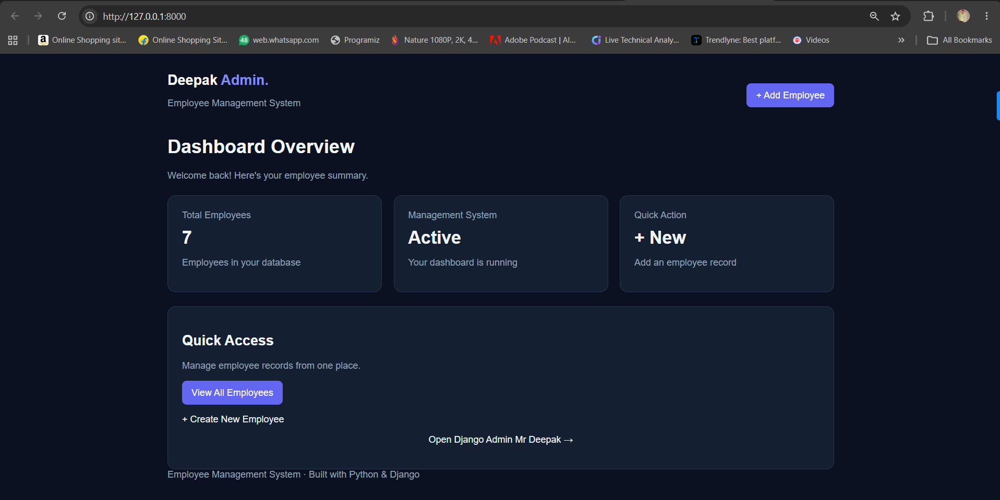
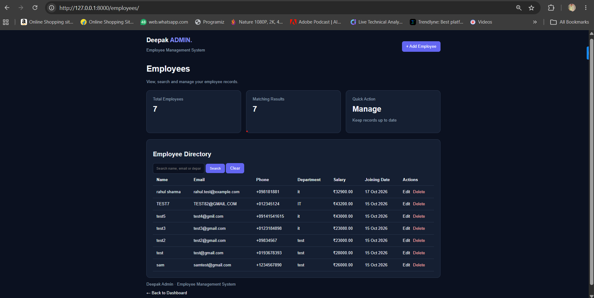
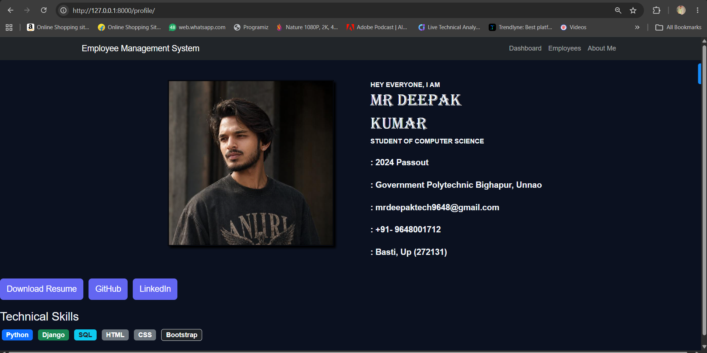

# Employee Management System

A web-based Employee Management System built using Python and Django.

## Features

- User login and authentication
- Add, view, edit, and delete employee records
- Search employees by name, email, and department
- Protected pages for authenticated users
- Django admin integration
- Responsive dark-themed user interface

## Technologies Used

- Python
- Django
- SQLite
- HTML
- CSS
- Bootstrap

## Project Structure

- `config/` — Django project configuration
- `employees/` — Employee application
- `manage.py` — Django management utility
- `media/` — Resume PDF file

## Run Locally

1. Clone the repository:

   ```bash
   git clone https://github.com/mrtechdeepak/EmployeeManagementSystem.git
   ```

2. Open the project directory:

   ```bash
   cd EmployeeManagementSystem
   ```

3. Create and activate a virtual environment:

   ```bash
   python -m venv venv
   ```

   Windows PowerShell:

   ```powershell
   .\venv\Scripts\Activate.ps1
   ```

4. Install Django and other required dependencies. If a `requirements.txt` file is available:

   ```bash
   pip install -r requirements.txt
   ```

5. Apply migrations:

   ```bash
   python manage.py migrate
   ```

6. Create an admin account:

   ```bash
   python manage.py createsuperuser
   ```

7. Start the development server:

   ```bash
   python manage.py runserver
   ```

8. Open `http://127.0.0.1:8000/` in your browser.

## Author

**Deepak Kumar**

- GitHub: https://github.com/mrtechdeepak
- LinkedIn: https://www.linkedin.com/in/mrtechdeepak/

---

*This project was developed for learning and demonstrating Python/Django web development skills.*

## Screenshots

### Dashboard


### Employee List


### About Me

## Screenshots

### Dashboard


### Employee List


### About Me
